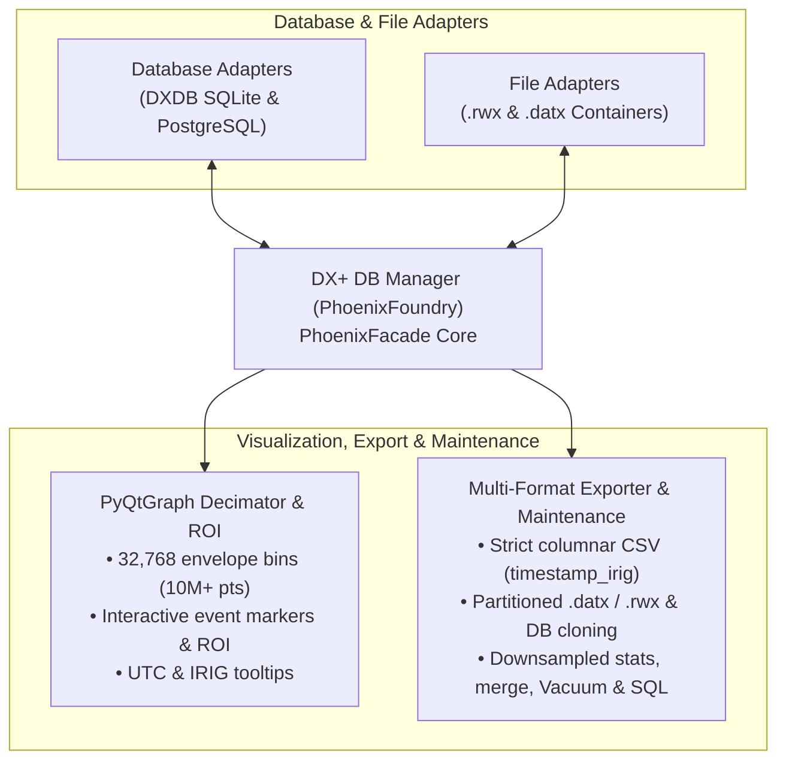

# PhoenixFoundry — DX+ DB Manager User Guide

`DX+ DB Manager` (`PhoenixFoundry`, executable `dx+dbmanager.exe`) is the enterprise desktop application for inspecting, visualizing, maintaining, and converting high-rate industrial telemetry databases (`.dxdb`, SQLite, PostgreSQL) and file recordings (`.rwx`, `.datx`) across the Phoenix Ecosystem.

---

## 1. System Overview



### Core Capabilities
1. **Inspection & Multi-Database Session Management**:
   - Connect simultaneously to multiple `.dxdb` (SQLite) and enterprise PostgreSQL databases and switch between active connections using the top ribbon dropdown.
   - Auto-discover physical datasources, signal channels, inter-sample intervals (`delta`), and engineering units (`psi`, `degC`, `V`, `g`, `RPM`, etc.).
   - Inspect hierarchical partition tables (`APEX_DATA`, `DS_DATA`) and discrete event markers (`APEX_DATAPOINT`, `DS_EVENT`) with human-readable UTC and IRIG date-time formatting.
2. **High-Performance Waveform Visualization & Event Tagging**:
   - Two-pass memory-bounded min/max envelope decimation capable of rendering 10,000,000+ data points smoothly at 60 FPS in `pyqtgraph`.
   - Interactive Region of Interest (ROI) selection with nanosecond precision for targeted exports and **Create Event from ROI**.
   - Full Event creation, editing, and deletion with typed JSON key/value metadata table editing and automatic synchronization of `eventNumber`, `startTime`, `endTime`, and event `flags`.
3. **Strict Columnar CSV Export Engine**:
   - **Unified Columnar Format**: Single primary time column (`timestamp_irig` by default, `timestamp_utc`, or `timestamp_ns`) followed by `"Source.Stream"` channel columns.
   - **Full Rate Multi-Rate Synchronization**: When exporting channels with different sample rates, the highest-rate channel (smallest positive `delta`) drives the timeline. Slower channels maintain time synchronicity via sample-and-hold carry-forward across intervals and mid-stream gaps, outputting `0` prior to a delayed channel's first sample.
   - **Downsampled Statistics**: Bins telemetry across fixed time intervals with statistical reductions (`Average`, `Min`, `Max`, `Peak-to-Peak`, `RMS`), guaranteeing strictly unique, monotonically increasing row timestamps across database chunks.
4. **Binary Container Export, Database Cloning & File Import**:
   - Export records, events, or time windows to `.datx` and `.rwx` containers (`Single File`, `Channels` / Split by Stream, `Sample Rate`, or Split by Source/Time) or to new/existing `.dxdb` databases (`Single`, `Per Source`, `Per Stream` partitions).
   - Import `.rwx` and `.datx` recordings into an active database or synthesize a brand-new database and auto-connect it in-session.
5. **Database Engineering & Maintenance Suite**:
   - `Vacuum` and `Optimize` database storage.
   - Apply timezone or custom second/millisecond/microsecond time offsets to a whole record, a specific datasource, or an individual stream.
   - Synchronize record `create_time` / `complete_time` boundaries to raw sample extrema.
   - Reduce recording data strictly to active event ranges to reclaim disk space.
   - Consolidate and merge overlapping records within a single database or across multiple physical database archives.
   - Execute ad-hoc diagnostic queries in the built-in **Query** SQL console.

---

## 2. Supported Adapters & Formats

| Adapter Display Name | Native Identifier | Extensions / Transport | Role |
| :--- | :--- | :--- | :--- |
| **DXDB / SQLite Reader** | `DXDBReader` | `.dxdb`, `.db`, `.sqlite` | Reads SQLite-backed Phoenix recordings (including multi-part partitioned `.dxdb` archives). |
| **DXDB / SQLite Writer** | `DXDBWriter` | `.dxdb`, `.db`, `.sqlite` | Creates or writes SQLite-backed Phoenix databases (`Single`, `Per Source`, `Per Stream`). |
| **PostgreSQL Database Reader** | `PostgreSQL Database Reader` | Network / URI | Reads from enterprise PostgreSQL telemetry stores. |
| **PostgreSQL Database Writer** | `PsqlDBWriter` | Network / URI | Writes records into enterprise PostgreSQL telemetry stores. |
| **RWX File Reader** | `RwxReader` | `.rwx` | Reads high-throughput RWX binary time-series containers. |
| **RWX File Writer** | `RWXWriter` | `.rwx` | Exports records into single or multi-part RWX files. |
| **DATX File Reader** | `DatxReader` | `.datx`, `.datx_index` | Reads industrial DATX binary containers. |
| **DATX File Writer** | `DatxWriter` | `.datx` | Exports records into single or multi-part DATX files. |

---

## 3. Step-by-Step Operator Guide

### 3.1 Launching the Application
```powershell
# Frozen executable
dx+dbmanager.exe

# From Python source
py -3 apps/PhoenixFoundry/src/main.py
```
Upon startup, `DX+ DB Manager` checks out the `FOUNDRY-APP` license feature via `PhoenixLic`, displays the splash screen, and opens the main ribbon workspace.

### 3.2 Connecting to & Switching Between Databases
1. Click **Connect DB** on the top ribbon.
2. In the **Connect to Database** dialog:
   - Choose the **Database Adapter** (`DXDB / SQLite Reader` or `PostgreSQL Database Reader`).
   - For file-backed databases, click **Browse...** to select a `.dxdb` file.
   - For network DBMS adapters, fill in the dynamically generated connection parameters (`host`, `port`, `user`, `password`, `database`).
3. Click **Connect**.
4. The connection is added to the **Active DB** selector on the ribbon, and the left sidebar tree populates with all discovered **Records** (`Record 1`, `Record 2`, ...) and their child **Events** (`Event 1`, ...).
5. To switch between multiple open databases, select another connection from the ribbon dropdown. Click **Close DB** to disconnect the active database.

### 3.3 Inspecting Metadata, Plotting Waveforms & Managing Events
1. **Overview View**:
   - Select any **Record** or **Event** in the left sidebar.
   - The **Overview** panel displays formatted UTC and IRIG start/end timestamps, duration, datasource/stream counts, partition tables, and metadata.
   - Click **View Graph Schema** to inspect the raw and tree-structured `graph_json` and `tables_json` descriptors.
2. **Plot View & Interactive ROI**:
   - Switch to the **Plot** view on the ribbon.
   - Choose a **Source** and **Stream** from the dropdown selectors and click **Plot Stream**.
   - **Pan / Zoom**: Left-click and drag to pan; right-click and drag or use the mouse wheel to zoom.
   - **Region of Interest (ROI)**: Drag the shaded ROI boundary handles on the plot (or edit the start/end time fields) to isolate a subsecond time window.
   - **Event Markers**: Toggle **Show Events** to overlay vertical event boundaries (`E1>`, `<E1`).
3. **Creating, Editing & Deleting Events**:
   - **Create Event from ROI**: Adjust the plot ROI to the desired window and click **Create Event from ROI**. Enter an **Event Number**, comma-separated **Event Flags** (e.g. `burn,maxq`), and custom key/value metadata rows, then click **OK**.
   - **Edit Event**: Select an event in the sidebar and click **Edit Event** to modify its event number, start/end timestamps, flags, or typed JSON metadata attributes.
   - **Delete Event**: Select an event and click **Delete Event** (confirms before removal).

### 3.4 Exporting to Columnar CSV
1. Click **Export CSV** on the ribbon.
2. Select the **Target Record**, channels to include, and **Range Mode**:
   - **Full Record**: Exports the complete record duration.
   - **Event Range**: Clips strictly to the selected event's exact nanosecond start/end bounds.
   - **Time Range (ROI)**: Clips strictly to the active plot ROI selection.
   - **Custom Time Range**: Specify custom UTC start and end timestamps.
3. Choose the **Time Format**:
   - **IRIG** *(Default)*: `YYYY:DDD:HH:MM:SS.fffffffff` (header: `timestamp_irig`).
   - **IRIG (Day of Year)**: `DDD:HH:MM:SS.fffffffff` (header: `timestamp_irig`).
   - **ISO 8601 (UTC)**: `YYYY-MM-DD HH:MM:SS.fffffffff` (header: `timestamp_utc`).
   - **Unix Epoch (ns)**: Raw integer nanoseconds (header: `timestamp_ns`).
4. Choose the **Export Mode**:
   - **Full Rate**: Highest-rate channel drives the timeline; slower channels use sample-and-hold carry-forward (and `0` before first sample).
   - **Downsampled**: Enter a bin **Duration (s)** (e.g. `0.1` for 100 ms) and choose a statistic (`Average`, `Min`, `Max`, `Peak-to-Peak`, `RMS`).
5. Pick an output `.csv` file path and click **Export**.

### 3.5 Exporting & Importing Binary Files (`.datx`, `.rwx`, `.dxdb`)
- **Export File (`.datx` / `.rwx`)**: Click **Export File**, select `DATX File Writer` or `RWX File Writer`, choose the range and layout mode (`Single File`, `Channels` / per-stream, or `Sample Rate` / per-source), and click **Export**.Part filenames automatically use `GraphJson` logical names.
- **Export DXDB**: Click **Export DXDB**, select the destination database writer adapter, target `.dxdb` path, and SQLite partition mode (`Single`, `Per Source`, `Per Stream`), and click **Export**.
- **Import File**: Click **Import File**, select `RWX File Reader` or `DATX File Reader`, choose the source `.rwx`/`.datx` file, and choose whether to import into the **Current Active DB** or create a **New Database** (which is automatically connected and loaded into the session upon completion).

### 3.6 Database Maintenance & Merging (`Database Tools`)
Click **Database Tools** on the ribbon to open the engineering maintenance dialog:
- **Vacuum / Optimize**: Defragment database pages and refresh query planner statistics.
- **Time Offset**: Shift timestamps by a **Timezone Offset** or **Custom Offset** (seconds, milliseconds, microseconds) scoped to the entire record, a specific source, or a specific stream.
- **Sync Record Bounds**: Update `create_time` and `complete_time` in `DS_INDEX` to match exact minimum/maximum sample timestamps in the data tables.
- **Reduce Data to Event Ranges**: Permanently delete raw data samples outside defined event windows (requires confirmation).
- **Delete Record + Related Data**: Cascade delete a record, its events, and its data partitions (requires confirmation).
- **Merge Records**:
  - **Same-Database Merge**: Consolidate all records overlapping a specified start/end time window into a single record.
  - **Cross-Database Merge**: Select multiple source databases, choose a destination writer and URI, and synthesize a consolidated master database.
- **SQL Query Console**: Switch to the **Query** view on the main ribbon to execute custom SQL queries and inspect tabular results.
