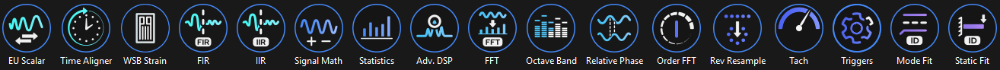

# Phoenix API Developer Guide

**Phoenix API** is a **C++20** and **Python (`phoenixpy`)** modular data acquisition, DSP pipeline, streaming, storage, and digital twin SDK powering the APEX Phoenix / DX+ platform.

## Architecture Overview

Phoenix organizes acquisition and analytics into a directed acyclic pipeline executed by `ComponentManager`:

1. **Component Graph (`GraphJson` & `TableJson`)**: Describe computational topologies directly as component graphs ([`GraphJson`](PhoenixCore/GraphJson.md)) or channel-oriented setup tables compiled via `StreamTableManager` ([`TableJson`](PhoenixCore/TableJson.md)).
2. **Zero-Copy Messaging (`Message`)**: Transfer time-series vectors, spectra, scalar alerts, video frames, modal fits, and composite message trees with nanosecond UTC timestamps and ref-counted buffers ([`Message`](PhoenixCore/Message.md)).
3. **Dynamic Plugin Managers (`PhoenixLibraryManager`)**: Discover and load shared libraries at runtime using standardized C factory symbols:
   - **Components** (`GetComponents` via `ComponentLibraryManager`) — Inputs, DSP Processors, Outputs, Viewers
   - **Devices** (`GetDevices` via `DeviceLibraryManager`) — Hardware drivers (`Device` NVI interface)
   - **Files** (`GetFiles` via `FileLibraryManager`) — `.rwx` and `.datx` file readers/writers
   - **Databases** (`GetDatabases` via `DatabaseLibraryManager`) — `SQLite` and `PostgreSQL`
   - **Streams** (`GetStreams` via `StreamLibraryManager`) — `DXPNet` ZeroMQ and `DSNet` DS 3.x ingestion
   - **Video & Virtual** (`GetVideoIO`, `GetVirtuals`) — Video capture and VTK-based digital twin virtual sensors
4. **Apex License Manager (`PhoenixLic` / `ApexLmClient`)**: CurveZMQ (`27884`) + Ed25519 JSON licensing for `PHOENIX` (`7e2c9a45-0d61-4f38-95b2-6c840e3a7f16`), DX+ modules, and device hardware serial checks.

## Developer Guides

### C++20 SDK
- [C++20 SDK Overview & CMake Setup](C++/README.md)
- [Licensing (`PhoenixLic` & `ApexLmClient`)](C++/licensing.md)
- [Pipelines, Components & `StreamTableManager`](C++/pipeline-and-components.md)
- [Devices, Live Streams, File I/O & Databases](C++/devices-streams-and-io.md)
- [Data Types, Time Sync, Units, Limits & Virtual Sensors](C++/data-types-and-utilities.md)
- [Writing Custom C++ Component & Device Plugins](C++/custom-plugins.md)

### Python (`phoenixpy` SWIG Bindings)
- [Installing & Configuring `phoenixpy`](Python/README.md)
- [Licensing from Python](Python/licensing.md)
- [Building & Running Pipelines](Python/pipelines-and-graphs.md)
- [File, Database & Stream I/O in Python](Python/data-io-and-databases.md)
- [Python Module Reference](Python/module-reference.md)

## Subsystem & Catalog References

- **PhoenixCore Architecture**:
  - [PhoenixCore Overview](PhoenixCore/PhoenixCore.md) · [PhoenixLic](PhoenixCore/PhoenixLic.md) · [Ports & Endpoints](PhoenixCore/ports.md)
  - [Component](PhoenixCore/Component.md) · [Device](PhoenixCore/Device.md) · [File](PhoenixCore/File.md) · [Database](PhoenixCore/Database.md) · [Stream](PhoenixCore/Stream.md)
  - [GraphJson](PhoenixCore/GraphJson.md) · [TableJson](PhoenixCore/TableJson.md) · [Message](PhoenixCore/Message.md) · [Utilities](PhoenixCore/Utilities.md) · [Virtual](PhoenixCore/Virtual.md)
- **Built-in Component Catalog (`GetComponents`)**:
  - [Inputs](Components/Inputs/README.md) · [Processors](Components/Processors/README.md) · [Outputs](Components/Outputs/README.md)
  - [APEX-H5 Output Format (`HDF5Output`)](readme/outputs/apex-h5.md) · [HDF5Output Settings](Components/Outputs/HDF5Output.md)
- **Phoenix Applications**:
  - [Apps Overview](Apps/README.md) · [PhoenixEngine](Apps/PhoenixEngine.md) · [PhoenixFoundry](Apps/PhoenixFoundry.md) · [PhoenixOPCUA](Apps/PhoenixOPCUA.md) · [PhoenixPLC](Apps/PhoenixPLC.md)
